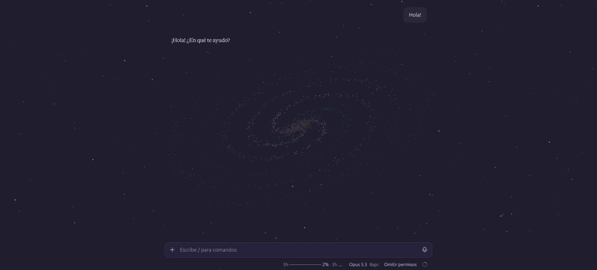

# ocsky galaxy

A dark look for Claude Code in the desktop and mobile apps, after the galaxy backdrop of
[ocsky](https://github.com/iDiagoValeta/ocsky), a terminal view of opencode agents.

- Colours from Rosé Pine (main), taken from the palette the Rosé Pine project publishes.
- A spiral galaxy drawn as square grains on a grid sits in the middle of the window. It turns once
  every four minutes, its grains fade out and back in by turns, faint stars twinkle around it and a shooting star crosses now and then.
- With reduced motion turned on in the system, everything stands still.

It sets the theme when a session starts and needs no setup. The terminal and editors draw no
themes, so there it does nothing.



## Install

At the prompt of a Claude Code terminal session:

```
/plugin install ocsky-galaxy --marketplace iDiagoValeta/ocsky-galaxy
```

From a shell:

```bash
claude plugin install ocsky-galaxy --marketplace iDiagoValeta/ocsky-galaxy
```

In the desktop app: click + next to the prompt box, then Plugins, Add marketplace with
`iDiagoValeta/ocsky-galaxy`, then Add plugin.

## Changing the scene

`hooks/scene.ts` is generated. Edit `tools/gen_scene.py` and run `python3 tools/gen_scene.py`
from the repository root.

## License

Apache-2.0
